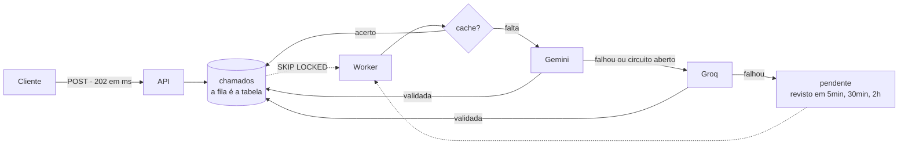

# Triagem de Chamados com IA resiliente

[](https://github.com/alcantarajv/triagem-chamados/actions/workflows/ci.yml)
[](LICENSE)

API REST que recebe chamados de suporte em texto livre e usa um modelo de linguagem para classificá-los — categoria, prioridade e um resumo de uma linha —, construída em Java 21 com Spring Boot 4, Spring AI, Resilience4j e PostgreSQL.

O que este projeto resolve não é o prompt. É a engenharia de backend em volta de uma dependência que **demora, falha, cobra por uso e às vezes responde algo fora do combinado**.

---

## No ar

**<https://triagem-chamados-yh4a.onrender.com>**

[Demonstração ao vivo](https://triagem-chamados-yh4a.onrender.com) · [Health](https://triagem-chamados-yh4a.onrender.com/actuator/health) · [Métricas](https://triagem-chamados-yh4a.onrender.com/actuator/prometheus)

A raiz traz uma página que abre um chamado **ao vivo**: ela mostra o `POST` respondendo em milissegundos com `202`, enquanto a triagem acontece depois, num worker — e, quando ela termina, qual provedor respondeu, se houve fallback, se a classificação veio do cache e quanto cada etapa levou. Não cole dados pessoais: o texto vai para provedores de IA em plano gratuito.

O serviço roda no plano gratuito do Render e hiberna quando ocioso: a primeira requisição depois de um tempo parado leva cerca de um minuto para responder — as seguintes são imediatas.

---

## Sumário

- [No ar](#no-ar)
- [O problema central](#o-problema-central)
- [Decisões técnicas](#decisões-técnicas)
  - [Registro completo das 31 decisões](docs/decisoes-tecnicas.md)
- [API](#api)
- [Como rodar](#como-rodar)
- [Testes](#testes)
- [Stack](#stack)
- [Projetos relacionados](#projetos-relacionados)
- [Autor](#autor)
- [Licença](#licença)

---

## O problema central

> **O que acontece com a triagem quando o provedor de IA demora 30 segundos, cai, estoura a cota ou responde algo que não está no formato pedido?**

A versão ingênua chama o provedor dentro da requisição do cliente e devolve o que vier:

```java
@PostMapping("/api/chamados")
Chamado criar(@RequestBody NovoChamado novo) {
    Triagem triagem = modelo.classificar(novo.texto());   // <-- o cliente espera por isto
    return repositorio.save(new Chamado(novo, triagem));
}
```

Ela funciona no teste com o provedor no ar e tem cinco defeitos que só aparecem em produção. Cada um tem a sua solução, e cada solução tem um teste que provoca a falha correspondente:

| # | Defeito da versão ingênua | Como o projeto responde | Teste que comprova |
|---|---|---|---|
| 1 | A latência do provedor vira a latência da API | o `POST` só grava e responde `202`; um worker tria depois, pegando a fila no banco com `SKIP LOCKED` | `ChamadoIT`, `TriagemConcorrenteIT` |
| 2 | Uma falha do provedor vira `500` e o chamado se perde | um segundo provedor assume, um circuit breaker pula quem está fora, e se todos falharem o chamado fica pendente e é revisto mais tarde | `FallbackIT`, `DisjuntorIT`, `DegradacaoIT` |
| 3 | Repetir sem critério | tempo limite em toda chamada; nova tentativa só para erro transitório, com espera crescente e respeitando a espera que o provedor pedir | `RepeticaoIT` |
| 4 | A saída do modelo é tratada como confiável | a resposta é validada antes de ser aceita, e a inválida ganha uma — e só uma — correção com o erro apontado | `ValidacaoDaRespostaIT` |
| 5 | Não há controle de custo | cache por texto normalizado, orçamento diário por provedor e limite de chamados por cliente | `CacheIT`, `OrcamentoDiarioIT`, `LimiteDeChamadosIT` |



---

## Decisões técnicas

O projeto registrou 31 decisões ao longo do desenvolvimento, cada uma com o motivo, a alternativa descartada e como foi comprovada. As que estão abaixo são as que definem o projeto; o registro completo, agrupado por tema, está em **[docs/decisoes-tecnicas.md](docs/decisoes-tecnicas.md)**.

### A triagem fora da requisição

**O `POST` não depende de IA.** Ele grava o chamado como `RECEBIDO` e responde `202 Accepted` — e não `201`, porque o trabalho que o cliente quer ainda não aconteceu —, com o `Location` de onde acompanhar. Na página de demonstração, rodando localmente, o `POST` respondeu em 87ms e a triagem, depois, levou 2,5 segundos.

**A fila é a tabela, e a transação nunca espera o provedor.** O worker pega o chamado com `SELECT ... FOR UPDATE SKIP LOCKED`, mas não chama o modelo dentro da transação: isso seguraria uma conexão do pool durante os segundos de resposta, e com o provedor lento o pool se esgotaria e até o `POST` pararia. São três transações curtas — reservar, chamar o provedor sem transação, gravar —, e entre elas quem protege o chamado é uma **reserva com prazo** gravada nele. Worker que morre no meio não prende o chamado: a reserva vence e ele volta à fila. Quatro workers simultâneos sobre 30 chamados resultam em exatamente 30 requisições ao provedor, uma por texto.

**A reserva cobre a triagem mais demorada, e a aplicação confere.** No pior caso, com dois provedores, novas tentativas e correção, uma triagem leva 260 segundos; a reserva é de 5 minutos. Os números moram em lugares diferentes da configuração, e a aplicação **recusa subir** se a conta não fechar — o erro silencioso de produção vira um erro barulhento na largada.

### Não confiar no modelo

**A resposta é validada antes de ser aceita.** O adaptador devolve o texto bruto, e um validador recusa JSON cortado, categoria fora do `enum`, resumo vazio, longo demais ou com quebra de linha — tolerante na forma (`"tecnico"` vale como `TECNICO`), rigoroso no conteúdo. A saída estruturada nativa (`response_format` com o esquema JSON) reduz os erros, mas pedir um formato não é garantir um formato.

**Uma correção, e só uma.** A resposta inválida volta ao modelo com a lista de todos os motivos da recusa, numa continuação da conversa. Se ele errar de novo mesmo sabendo o que errou, a vez passa ao próximo provedor: insistir tende a repetir o erro e gasta cota. Testado contra o Gemini real com uma resposta forjada com `URGENTE`: ele devolveu `FINANCEIRO`.

### Resiliência com critério

**Só o transitório se repete.** Tempo esgotado, `5xx` e `429` ganham até três tentativas, com espera crescente e variação aleatória; `400`, `401`, `404` geram exatamente uma requisição, porque repetir dá a mesma recusa. Quando o provedor diz quanto esperar, a espera dele vale; se pedir mais que 10 segundos, a vez passa direto ao próximo provedor.

**O Gemini não manda `Retry-After`.** O `429` real, provocado com uma rajada contra a cota gratuita, chega sem o cabeçalho, com a espera no corpo (`google.rpc.RetryInfo`, `"retryDelay": "26s"`). A aplicação lê os dois. Sem isso, ela tentaria de novo em 1 e 2 segundos quando o Gemini pediu 26, e receberia mais dois `429`.

**O SDK não repete escondido.** O SDK da OpenAI, que o Spring AI 2.0 usa, repete até três vezes por padrão sem a aplicação saber — religado no padrão, um único `500` virou quatro requisições. Desligado: com as duas políticas ligadas, as tentativas se multiplicariam, até quatro do SDK para cada uma da aplicação.

**Fallback e circuit breaker por provedor.** O Gemini é o principal e o Groq o secundário, e cada um tem a sua chance inteira antes de a vez passar. Depois de cinco falhas seguidas, o circuito do provedor abre e ele é pulado **sem requisição nenhuma** por um minuto — o teste confere zero requisições novas no WireMock durante a janela. O circuito fica *dentro* da nova tentativa, contando cada tentativa; de fora, levaria três vezes mais requisições inúteis para abrir.

**Resilience4j, e não o Spring Framework 7.** O `RetryTemplate` do Spring calcula a espera sem receber a falha (`BackOffExecution.nextBackOff()` não tem parâmetro), então não há como esperar o que cada `429` pede; o `IntervalBiFunction` do Resilience4j recebe. E o Spring 7 não tem circuit breaker.

**Nada se perde.** Se todos os provedores falharem, o chamado fica `PENDENTE_TRIAGEM_MANUAL` — não há estado de "erro" — e ganha uma nova tentativa agendada, com espera crescente (5 minutos, 30 minutos, 2 horas). Depois da quarta falha, espera uma pessoa. A API continua respondendo `202` e `200`, nunca `500`, e o CI comprova isso na imagem de produção, sem chave de provedor nenhuma.

### Custo sob controle

**Cache por texto normalizado, guardando só o hash.** Maiúsculas, acentos e espaços não mudam a chave; pontuação e palavras mudam, porque um acerto de cache errado entrega a classificação de outro chamado. A chave inclui uma impressão digital das instruções enviadas ao modelo: mudou o prompt, as classificações antigas deixam de valer sozinhas.

**Orçamento diário no fuso do provedor.** A cota do Gemini vira à meia-noite do Pacífico, e o orçamento conta o dia no mesmo fuso. A reserva de cada requisição é uma única instrução SQL condicional: vinte reservas simultâneas pelas cinco últimas requisições do dia dão exatamente cinco.

**Limite por cliente, com o IP medido em produção.** São 10 chamados por hora por IP, com `429` e `Retry-After` — o mesmo cabeçalho que a aplicação respeita dos provedores. O primeiro endereço do `X-Forwarded-For`, o que quase todo exemplo usa, é o que o cliente controla. Como o Render não documenta o próprio comportamento, a aplicação ganhou um log que registra só o *formato* dos cabeçalhos, e a medição mostrou a Cloudflare sobrescrevendo o `True-Client-IP`. Em produção, com dez chamados aceitos na hora — sete deles com cabeçalhos de IP forjados, diferentes a cada vez —, o 11º, também forjado, recebeu `429`; e um chamado de outra rede, na mesma janela, foi aceito.

### Privacidade e observabilidade

**O texto do chamado não sai daqui.** Ele não vai para o log, nem para as métricas, nem para o cache. E a página de demonstração não usa `innerHTML`: o resumo é escrito pelo modelo a partir de um texto que o visitante controla, e um chamado feito para induzir HTML viraria XSS. Um teste lê o script da página e falha se aparecer `innerHTML`.

**Métricas por provedor no Prometheus.** Latência com histograma, tokens cobrados, provedores pulados, fallbacks, acertos de cache, respostas inválidas, o tamanho da fila e o orçamento do dia — o que o health check não mostra. Os tokens são medidos pela aplicação, porque as métricas prontas do Spring AI marcariam os dois provedores como `openai`.

---

## API

| Método | Caminho | Resposta |
|---|---|---|
| `POST` | `/api/chamados` | `202` com o chamado `RECEBIDO` e o cabeçalho `Location`; `429` com `Retry-After` passado o limite de 10 por hora |
| `GET` | `/api/chamados/{id}` | `200` com o chamado e, depois da triagem, a classificação; `404` se não existir |
| `GET` | `/actuator/health` | estado da aplicação e do banco |
| `GET` | `/actuator/prometheus` | métricas no formato do Prometheus ([o que cada uma responde](docs/decisoes-tecnicas.md#métricas-por-provedor-no-formato-do-prometheus)) |

Erros saem em Problem Details (RFC 9457), inclusive o `500`, com um `type` estável por tipo de erro.

```bash
curl -i -X POST http://localhost:8080/api/chamados \
  -H "Content-Type: application/json" \
  -d '{"texto":"Nao consigo emitir a segunda via do boleto pelo aplicativo."}'
```

```http
HTTP/1.1 202
Location: /api/chamados/01a14017-21df-765a-b296-3313c66561a1
Content-Type: application/json

{
  "id": "01a14017-21df-765a-b296-3313c66561a1",
  "texto": "Nao consigo emitir a segunda via do boleto pelo aplicativo.",
  "status": "RECEBIDO",
  "criadoEm": "2026-10-15T15:03:40.246298Z",
  "triagem": null,
  "proximaTentativaAutomatica": null
}
```

Depois que o worker triar o chamado, o `GET` traz a classificação e como ela foi obtida: quem respondeu, se houve fallback, se veio do cache e quanto a triagem levou. Resposta real, com o Gemini fora do alcance de propósito e o Groq respondendo no lugar dele:

```json
{
  "id": "01a140fa-aa95-71a0-aa58-0450c2292ec1",
  "texto": "O leitor de código de barras do caixa parou de funcionar depois da troca do computador da loja.",
  "status": "TRIADO",
  "criadoEm": "2026-10-15T19:12:11.916205Z",
  "triagem": {
    "categoria": "TECNICO",
    "prioridade": "ALTA",
    "resumo": "Leitor de código de barras do caixa parou de funcionar após troca de computador.",
    "provedor": "groq",
    "doCache": false,
    "fallback": true,
    "provedoresQueFalharam": ["gemini"],
    "duracaoMs": 5167,
    "triadoEm": "2026-10-15T19:12:17.443863Z"
  },
  "proximaTentativaAutomatica": null
}
```

`duracaoMs` é o tempo da triagem em si — aqui, as três tentativas recusadas no Gemini, as esperas entre elas e a resposta do Groq. A diferença entre `criadoEm` e `triadoEm` soma a isso a espera na fila.

Se nenhum provedor resolver, o status vira `PENDENTE_TRIAGEM_MANUAL`, `triagem` continua `null` e `proximaTentativaAutomatica` diz quando o revisor tenta de novo. Pendente com esse campo `null` esgotou as tentativas automáticas e espera uma pessoa.

---

## Como rodar

Pré-requisitos: Java 21 e Docker. O Maven não precisa estar instalado — o wrapper (`mvnw`) baixa a versão certa.

```bash
cp .env.example .env
docker compose up -d
./mvnw spring-boot:run
```

No Windows, use `mvnw.cmd` no lugar de `./mvnw`.

Para a triagem automática funcionar, coloque no `.env` as chaves dos provedores: a do Gemini, gerada em <https://aistudio.google.com> (**Get API key**), e a do Groq, gerada em <https://console.groq.com> (**API Keys**). Com uma só, a cadeia fica só com aquele provedor; sem nenhuma, a aplicação sobe do mesmo jeito e os chamados vão para triagem manual. No plano gratuito, o Google pode usar o conteúdo enviado para melhorar os modelos: não envie dados reais.

A aplicação sobe em <http://localhost:8080>, com a página de demonstração na raiz.

### Tudo em contêiner

A mesma imagem que vai para produção, construída pelo `Dockerfile`, sobe junto com o banco num profile do Compose:

```bash
docker compose --profile completo up --build
```

### Sem Docker Compose

Pela IDE, a classe `TestTriagemApplication` sobe a aplicação com um PostgreSQL descartável via Testcontainers — o banco nasce com o processo e morre junto, e cada execução começa limpa.

---

## Testes

**156 testes: 57 unitários e 99 de integração.** Nenhum chama um provedor real, e o CI não tem chave nenhuma.

```bash
./mvnw test
```

Só os unitários — validação, tradução de falhas, normalização, estados —, sem Docker: **cerca de 7 segundos**.

```bash
./mvnw verify
```

A suíte inteira, com PostgreSQL de verdade em contêiner e o WireMock no papel dos provedores: **cerca de 1 minuto**. Exige Docker ligado.

### O provedor é um WireMock, e o tempo é um relógio que o teste move

| | Unitários (`*Test`) | Integração (`*IT`) |
|---|---|---|
| Rodados por | Surefire | Failsafe |
| Dependem de | nada | PostgreSQL + dois WireMocks |
| Provam | a regra | que as peças se encaixam pela rede |
| Exemplo | o `Retry-After` em segundos ou data HTTP | quatro workers sobre a mesma fila |

- **Dois WireMocks, um por provedor**, servindo HTTP de verdade no formato da API da OpenAI. Um provedor falso em memória seria mais rápido, mas não provaria o que vai pela rede — e, principalmente, não contaria **quantas requisições chegaram**, o número que sustenta os testes de repetição, circuit breaker e cache.
- **PostgreSQL de verdade**: a fila depende de `FOR UPDATE SKIP LOCKED`, o orçamento e o limite de `INSERT ... ON CONFLICT ... RETURNING`. Um banco em memória validaria um sistema diferente do que roda em produção.
- **Um relógio que o teste avança**, injetado no lugar do `Clock` da aplicação: a janela do circuit breaker, a reserva do worker, as revisões espaçadas e a virada do dia no Pacífico passam num instante. As esperas de nova tentativa, ao contrário, acontecem de verdade — encurtadas —, e os intervalos são medidos pelo horário em que cada requisição chegou ao WireMock.
- **Ambiente zerado entre testes**: banco, contagens dos WireMocks e circuitos. Sem isso, um teste que provoca três falhas deixaria o circuito a duas de abrir, e o seguinte falharia por um motivo que não é dele.

### Cenários

| Cenário simulado | O que o teste comprova | Classe |
|---|---|---|
| Vários workers ao mesmo tempo | cada chamado é triado uma única vez, com uma requisição por texto | `TriagemConcorrenteIT` |
| Provedor mais lento que o tempo limite | a chamada é abandonada no tempo limite e a nova tentativa resolve | `RepeticaoIT` |
| Provedor responde `5xx` ou `408` | nova tentativa com espera crescente; três falhas, exatamente três requisições | `RepeticaoIT` |
| Provedor responde `4xx` de requisição inválida | uma única requisição, sem repetição | `RepeticaoIT` |
| `429` com `Retry-After` ou `retryDelay` | a nova tentativa espera o que foi pedido; pedido acima da espera máxima, uma única requisição | `RepeticaoIT` |
| JSON inválido ou categoria inexistente | exatamente uma nova tentativa, com o erro no pedido; nunca uma terceira | `ValidacaoDaRespostaIT` |
| Principal lento, sem cota, fora do ar, com chave recusada ou inválido duas vezes | o secundário responde, com o pedido original | `FallbackIT` |
| Cinco falhas seguidas no principal | o circuito abre e o principal recebe zero requisições durante a janela; depois dela, uma chamada de teste fecha ou reabre | `DisjuntorIT` |
| Todos os provedores fora | a API responde `202` e `200`, e o chamado fica pendente com o texto intacto e a próxima tentativa agendada | `DegradacaoIT` |
| Pendente que continua falhando | as revisões se espaçam (5min, 30min, 2h) e, depois da quarta falha, nenhuma requisição a mais | `DegradacaoIT` |
| O mesmo texto duas vezes | a segunda triagem vem do cache, com zero requisições ao provedor | `CacheIT` |
| Orçamento do principal esgotado | o principal é pulado sem requisição e volta na virada do dia, no fuso dele | `OrcamentoDiarioIT` |
| Mesmo cliente passa de 10 chamados na hora | `429` com `Retry-After`; outro cliente não é afetado | `LimiteDeChamadosIT` |
| Métricas e página | triagem pelo principal, fallback, cache, resposta inválida, circuito aberto, orçamento, pendente e limite movem a métrica certa; o texto do chamado não aparece no Prometheus; a página não insere HTML | `MetricasIT`, `PaginaDeDemonstracaoIT` |

### Quando um teste passa, ele foi verificado

Os mecanismos centrais tiveram a proteção removida de propósito, para confirmar que o teste acusa:

| Proteção removida | O que o teste acusou |
|---|---|
| Novas tentativas do SDK desligadas (`maxRetries(0)`) | religadas no padrão, um único `500` virou **quatro** requisições |
| Espera do `Retry-After` | a segunda tentativa chegou em cerca de 100ms, antes do 1 segundo pedido |
| Circuit breaker | **cinco** dos seis testes do circuito falharam |
| Consulta ao cache | os dois testes de acerto de cache falharam |

### Conferido contra os provedores reais

Os testes automatizados nunca chamam um provedor real; os comportamentos que dependem dele foram conferidos à parte, com chamados fictícios:

| O que foi conferido | Resultado |
|---|---|
| Saída estruturada nativa | Gemini e Groq aceitam o esquema, o Groq em modo estrito |
| Correção de resposta inválida | com uma resposta forjada com `URGENTE`, o Gemini devolveu `FINANCEIRO` |
| `429` do Gemini | chega sem `Retry-After`, com a espera em `google.rpc.RetryInfo` no corpo |
| Fallback | com o Gemini inalcançável, três tentativas recusadas e o Groq triou o chamado |
| Degradação | com os dois inalcançáveis, `202` em 90ms e chamado pendente; com eles de volta, o revisor o triou |
| Limite por IP, em produção | com cabeçalhos de IP forjados e diferentes a cada vez, o 11º chamado da hora recebeu `429`; outra rede, na mesma janela, recebeu `202` |
| Latência, em produção | primeira triagem depois do deploy em 19,4s (aquecimento); a seguinte, em 0,8s |

---

## Stack

Java 21 · Spring Boot 4.1 · Spring AI 2.0 · Resilience4j 2.4 · PostgreSQL 17 · Flyway · Micrometer/Prometheus · Google Gemini (`gemini-3.5-flash-lite`) · Groq (`openai/gpt-oss-20b`) · JUnit 6 · AssertJ · Testcontainers 2 · WireMock 3 · Docker · GitHub Actions · Render · Neon

---

## Projetos relacionados

Este é o quarto de uma série de quatro projetos, e cada um ataca um problema de backend que só aparece em produção:

1. [encurtador-links](https://github.com/alcantarajv/encurtador-links) — **latência**: cache com Redis, rate limiting, processamento assíncrono
2. [reserva-quadras](https://github.com/alcantarajv/reserva-quadras) — **concorrência**: constraint de exclusão do PostgreSQL e teste multi-thread
3. [api-pedidos](https://github.com/alcantarajv/api-pedidos) — **consistência entre sistemas**: idempotência e padrão outbox
4. **triagem-chamados** — **resiliência a uma dependência externa lenta, cara e instável**: fallback entre provedores de IA, circuit breaker, validação da resposta e controle de custo

---

## Autor

**João Vitor Alcântara Corrêa**
[joaoalcantara.dev](https://joaoalcantara.dev) · [GitHub](https://github.com/alcantarajv) · [LinkedIn](https://linkedin.com/in/joaovalcantara)

---

## Licença

[MIT](LICENSE).
